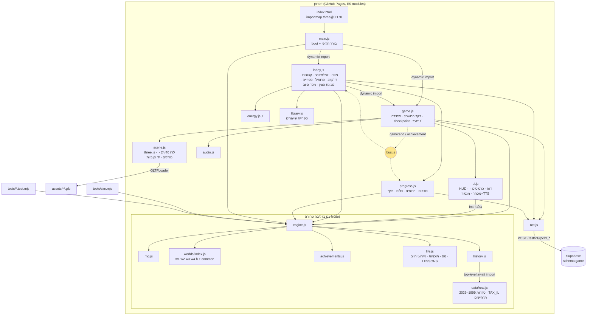
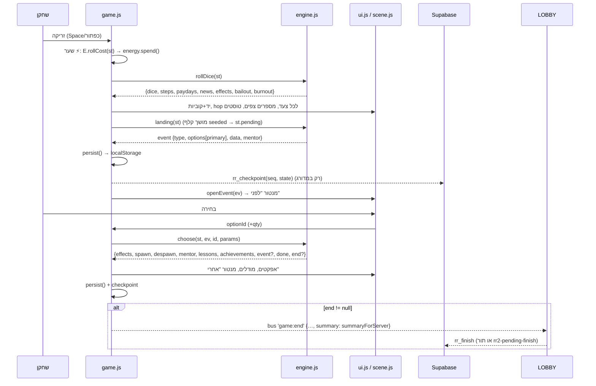
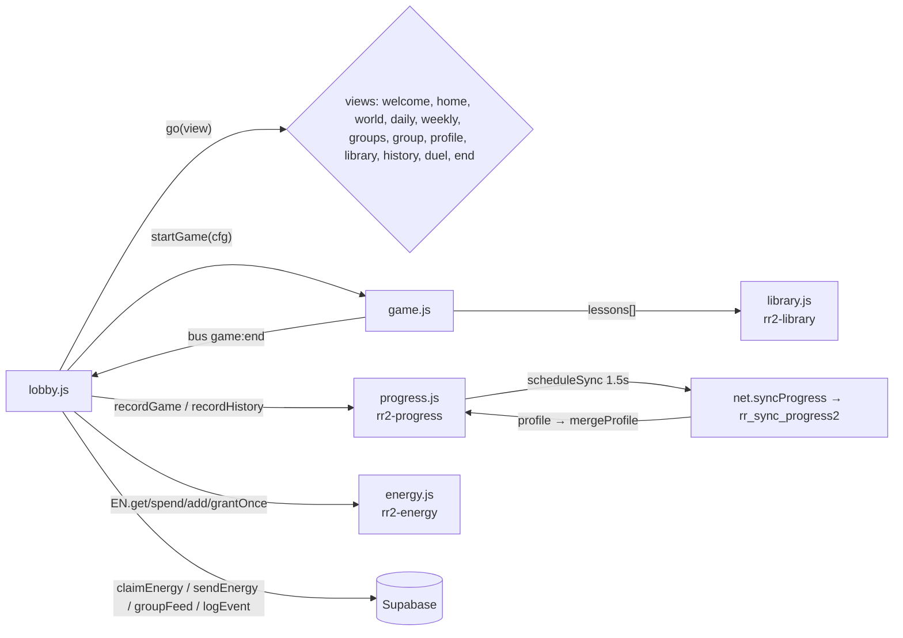

# ARCHITECTURE — מירוץ העכברים (v2 חי + v3 בעבודה)

> Chief Architect (תיעוד). מצב נכון ל־2026-11-20 15:10. החוזים המפורטים של ה־API נמצאים ב־`ENGINE.md` (מנוע → UI/לובי) וב־`docs-v3/DESIGN-v3.md`. המסמך הזה מתאר מבנה, זרימות וכללים, ולא משכפל אותם.

## 1. עקרונות

1. **סטטי, בלי build.** ES modules ישירות מ־GitHub Pages. three.js מ־CDN דרך importmap. לא מחליפים טכנולוגיה (חוק ברזל 12).
2. **מנוע טהור אחד.** כל חוק משחק וכל נוסחה כספית נמצאים ב־`engine.js` ובקבצי הנתונים שלו (`life.js`, `history.js`, `worlds/*`). UI ולובי **מציגים** את `metrics()` ואת אובייקט האירוע, ולא מחשבים כסף.
3. **דטרמיניזם.** אותו seed ⇒ אותן קוביות ואותם קלפים לכל שחקן, בלי קשר להחלטות שלו.
4. **השרת = זהות, תחרות, שמירה מדורגת.** כרגע הוא **לא** מריץ את המנוע (ראו §7).
5. **בעלות על קבצים.** לכל קובץ יש בעלים אחד (§8). חוזים בין בעלים נכתבים ב־ENGINE.md.

## 2. מפת מודולים



**הערה:** `history.js` טוען את `real.js` (36KB) ב־top-level await. מכיוון ש־`ui.js` ו־`lobby.js` מייבאים את המנוע סטטית, real.js נטען בכל עליית אפליקציה, אף שבמסמכים כתוב "loaded lazily". ההמלצה: `import()` רק כשנכנסים למצב היסטוריה, וגם `registerRealData` (שקיים כבר).

## 3. זרימת תור (מנוע ⇄ game.js ⇄ ui/scene)



פעולות "בכל זמן": `takeLoan`, `repayLoan`, `payCredit`, ובשלב v3 גם `setPlan`, `invest`, `setAutoInvest`. כולן מחזירות את אותה צורת תוצאה ואת `event` המעודכן. **לעולם לא שומרים event במטמון.** תמיד `result.event` או `currentEvent(st)`.

## 4. לובי, התקדמות ואנרגיה



- **מצבים:** `free` (⚡ 1 לזריקה, שמירה מקומית לכל עולם), `daily` / `weekly` / `challenge` (מדורג, ⚡ 0, `rr_begin` → seed+checkpoint, ניסיון אחד), `history` (⚡ 1, `scenarioId`), דו־קרב (`free` עם seed מהקישור).
- **יומי:** השרת (`game.day()`) קובע עולם, `char_index` ו־24 חודשים. `E.dailyConfig()` במנוע לא בשימוש בלובי (קוד מת. PROJECT_AUDIT D7).

## 5. שמירה, גרסאות ומיגרציה

| מפתח localStorage | בעלים | תוכן |
|---|---|---|
| `rr-player` | net.js | `{id, secret, nickname}`. הסוד = סיסמה |
| `rr2-save-free-<world>` / `rr2-save-<resultId>` | game.js | `{v:2, cfg, state, savedAt}` ← **גרסת עטיפה 2**, `state.v` = גרסת מנוע (3) |
| `rr2-progress` | progress.js | כוכבים, הישגים, כלי, רצף, היסטוריה, meta |
| `rr2-energy` | energy.js | `{e, at, granted}` |
| `rr2-library` | library.js | `{ids, read}` |
| `rr2-pending-finish` | lobby.js | תור `rr_finish` שלא נשלחו |
| `rr2-settings`, `rr2-coach`, `rr2-onboarded`, `rr2-seen-chal`, `rr2-ref`, `rr2-fallback` | game/audio/lobby/main | הגדרות ודגלים |

**גרסת state (`st.v`) ו־`SAVE_VERSION = 3`:**
- `deserialize()` מקבל `v=1` (הייצוג של v1/v2) ומעביר דרך `migrateV2()`: מיפוי 24→40 אריחים (`pos×40/24`, הזזה מפינה), streams חדשים, ברירות מחדל לחיים/מס/מדד. כל דבר אחר זורק `save_incompatible`, וה־UI מציג "המשחק השמור מגרסה ישנה — מתחילים מחדש".
- **כלל:** כל שדה חדש ב־state מקבל ברירת מחדל ב־`migrateV2` (או ב־`migrateV3` עתידי). העלאת `SAVE_VERSION` רק עם מיגרציה ובדיקה.
- **checkpoint מדורג:** אותו state בדיוק נשמר בשרת (`results.checkpoint`, `checkpoint_turn` = `S.ui.seq` מונוטוני). ב־`rr_begin` הלובי משווה בין השמירה המקומית ל־checkpoint, ו־seq גבוה יותר מנצח. חשוב: checkpoint שנשמר ב־v2 ונטען ב־v3 עובר את אותה מיגרציה.
- **סיכון פתוח:** שתי גרסאות (עטיפה 2 / מנוע 3) מבלבלות. לתעד ולא לשנות עכשיו, כי שינוי ישבור שמירות.

## 6. כללי דטרמיניזם (חובה לכל מכניקה חדשה)

1. במנוע ובנתונים אין `Math.random`, `Date`, DOM או `fetch`. נבדק ב־`engine & worlds use no Math.random / Date / DOM`.
2. כל אקראיות עוברת דרך `rng.js` עם **stream בשם**: `dice, deal, doodad, market, crisis, mystery, special, drift, life, index`. stream חדש מתווסף **בסוף** `STREAMS`, עם ברירת מחדל במיגרציה.
3. **צריכה לפי אריח, לא לפי החלטה.** כל הגרלה שתוצאתה תלויה בהחלטה (גורל סטארט־אפ, קבלת משא ומתן, העלאה, החזר הלוואה לחבר) נמשכת **ברגע משיכת הכרטיס** ונשמרת ב־`st.pending`. אסור להגריל ב־`choose()`.
4. בכל זריקה נמשכות שתי קוביות, גם בהדרכה, שבה התוצאה נדרסת.
5. אקראיות ויזואלית (חלקיקים, סיבוב יד) רק ב־`Math.random` בצד ה־UI, ולעולם לא משפיעה על state.
6. `landing()` אידמפוטנטי. `describe()` מחשב מחדש מספרים ו־`enabled` בלי לצרוך RNG.
7. מודולי `js/finance/*` (T-07/T-08) יהיו **פונקציות טהורות בלי RNG**. אם צריך אקראיות (ביקוש לעסק), המנוע מושך אותה מ־stream קיים ומעביר כפרמטר.
8. `replay(cfg, actions)` (בעבודה) חייב להחזיר state זהה ל־state החי. זה הבסיס לאימות בשרת.

## 7. Backend (Supabase `xvqaxphyfqdzkddmoosu`)

```mermaid
erDiagram
  players ||--o{ group_members : ""
  groups ||--o{ group_members : ""
  groups ||--o{ challenges : ""
  players ||--o{ results : ""
  challenges ||--o{ results : ""
  players ||--o{ energy_gifts : "from/to"
  players ||--o{ events : ""
  players { uuid id; text nickname; bytea secret_hash; jsonb stars; int total_stars; text_arr achievements; text pawn; int daily_streak; jsonb meta; uuid referred_by }
  results { uuid id; uuid player_id; uuid challenge_id; text weekly_key; text daily_key; text world; text status; int months; int net_worth; jsonb stats; jsonb checkpoint; int checkpoint_turn }
  challenges { uuid id; uuid group_id; text world; text profession; bigint seed; timestamptz ends_at }
```

| RPC | שימוש | הערות |
|---|---|---|
| `rr_register2(nick, ref)` → `rr_register` | רישום, הפניה +5⚡ | v2 החי קורא ל־`rr_register` |
| `rr_profile`, `rr_rename`, `rr_sync_progress2` (→`rr_sync_progress`) | פרופיל והתקדמות | מקסימום כוכבים, איחוד הישגים, meta |
| `rr_create_group`, `rr_join_group`, `rr_leave_group`, `rr_my_groups`, `rr_group`, `rr_create_challenge2` | קבוצות ואתגרים | |
| `rr_daily`, `rr_weekly` | לוחות + config | `game.day()`, `game.week()` |
| `rr_begin(mode, challenge)` | פתיחת/המשך מדורג | מחזיר seed + checkpoint. יוצר `results` |
| `rr_checkpoint(result, turn, state)` | שמירה בשרת | מונוטוני, ≤300KB |
| `rr_finish(...)` | תוצאה | פעם אחת. **ערכים מהלקוח** |
| `rr_send_energy`, `rr_claim_energy`, `rr_log_event`, `rr_group_feed` | v3 חברתי | unique ליום, 50 אירועים ליום |
| `rr_start`, `rr_create_challenge` | v1 (לא בשימוש) | לא למחוק בלי אישור |

**אבטחה:** כל ה־RPC הם `SECURITY DEFINER` עם `search_path=''` ו־`game.auth(id, secret)` (sha256). RLS מופעל בלי policies, כך שאין גישה ישירה לטבלאות.
**יעד (T-15):** Edge Function `verify-result` מקבלת `{result_id}`, טוענת `seed`, world, char ו־`actions` (מה־checkpoint או משדה חדש), מריצה `engine.replay()` (אותו קוד, Deno) ומשווה ל־`rr_finish`. בלי התאמה, התוצאה מסומנת `unverified` ולא נכנסת ללוח. **בלי שינוי הרסני בסכמה:** רק עמודה חדשה `verified boolean` (מיגרציה תוספתית, באישור).

## 8. מפת בעלות (מאוחד עם AGENT_ORGANIZATION.md)

| אזור | בעלים | קבצים | ממשק לאחרים |
|---|---|---|---|
| מנוע, חוקים, נתוני עולמות | ראש המנוע | `js/engine.js`, `js/rng.js`, `js/worlds/*`, `js/achievements.js`, `js/life.js`, `js/history.js`, `tools/sim.mjs`, `tests/engine.test.mjs`, `ENGINE.md` | ENGINE.md (API, אירועים, metrics) |
| נוסחאות בנק/השקעות | מהנדס בנק | `js/finance/bank.js`, `js/finance/invest.js`, `tests/finance.test.mjs` | **רק המנוע** מייבא אותם (T-09). UI לא |
| נוסחאות עסק | מהנדס עסקים | `js/finance/business.js`, `tests/business.test.mjs` | **רק המנוע** |
| נתונים אמיתיים | חוקר נתונים | `js/data/real.js`, `docs-v3/sources.md` | `TAX_IL`, `SERIES`, `SCENARIOS`, `seriesAt` |
| מסך משחק | ראש ממשק המשחק | `index.html`, `css/game.css`, `js/main.js`, `js/game.js`, `js/scene.js`, `js/ui.js`, `js/audio.js` | `bus` `game:end`; `startGame(cfg)` |
| מטא/לובי | ראש הלובי | `js/lobby.js`, `js/progress.js`, `css/lobby.css`, `js/energy.js`, `js/library.js` | `openLobby`, `showEndScreen` |
| תלת־ממד | ראש תלת־ממד | `assets/**`, `blender/*` | שמות מודלים = חוזה (ENGINE.md §4, DESIGN.md §3) |
| שרת, git, deploy | מתזמר | `js/net.js`, `js/bus.js`, Supabase, git | `net.*` |
| תיעוד אודיט/ארכיטקטורה | מבקר | `docs/PROJECT_AUDIT.md`, `FEATURE_MATRIX.md`, `ARCHITECTURE.md`, `TOOLS_AND_SKILLS_AUDIT.md` | — |

## 9. החלטות ארכיטקטורה פתוחות (דורשות הכרעה של המתזמר)

| # | החלטה | המלצה |
|---|---|---|
| A1 | איך `js/finance/*` משתלבים בלי ליצור מנוע כלכלי שני | ספריות נוסחאות טהורות. המנוע מחליף בהן את `loanPay/creditPay/assetCf/ROI` באותו PR, עם בדיקת "תוצאות זהות" על 2,000 משחקי seed לפני ואחרי (או הבדל מוסבר ומאוזן ב־sim) |
| A2 | הגדרת שווי נקי (עם/בלי פנסיה) | `netWorth` = בלי פנסיה (נזיל + נכסים − חובות), ו־`netWorthTotal` = כולל, כמו בקוד. לעדכן את ENGINE.md. מטרת w3/w4 נשארת על `netWorth` כדי לא לשבור איזון |
| A3 | טבלת מס אחת | `real.js TAX_IL` מקור. `life.js TAX` = עותק שנבדק כזהה בבדיקה |
| A4 | אימות בשרת | `replay()` + Edge Function (§7). לא מעבירים את ה־RNG לשרת בשלב הזה (שינוי ארכיטקטוני גדול) |
| A5 | טעינת real.js | עצלה, רק במצב היסטוריה |
